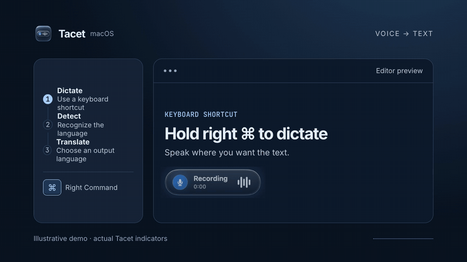

  

<h1 align="center">Tacet</h1>

**Diktieren aus der macOS-Menüleiste**

[Tacet-Website](https://lexus2016.github.io/tacet/?lang=de) · [Demo](https://lexus2016.github.io/tacet/?lang=de#demo) · **[Für Mac laden](https://github.com/Lexus2016/tacet/releases/latest)**

[English](README.md) · [Українська](README.uk.md) · Deutsch · [Español](README.es.md) · [Français](README.fr.md) · [Italiano](README.it.md) · [Polski](README.pl.md) · [Português](README.pt.md) · [Русский](README.ru.md)

Halte ein Tastenkürzel gedrückt und diktiere in der App, die du gerade nutzt. Tacet erkennt die Sprache und kann in deine Zielsprache übersetzen.

## Von der Stimme zum Satz

Sieh dir den Aufnahmeindikator, die automatische Spracherkennung und ein Übersetzungsbeispiel an.

| Einstellungen | Verlauf |
| --- | --- |
|  |  |

## Funktionen

- **Beim Diktieren die Sprache wechseln** Lass Tacet die Sprache für jedes Diktat erkennen oder lege sie selbst fest.
- **In einer Sprache sprechen. In einer anderen schreiben.** Wähle eine Zielsprache und verbinde einen Textanbieter. Tacet kann die Übersetzung in dieselbe App einfügen.
- **Ort der Spracherkennung wählen** Lade Parakeet für die Erkennung auf deinem Mac oder richte einen Cloud-Anbieter ein. Optionale Cloud-Funktionen senden Daten an den gewählten Anbieter.
- **Zwischenablage behalten** Tacet stellt die Zwischenablage nach dem automatischen Einfügen wieder her und speichert den Text im Verlauf.

## Installation

macOS 14+ · Apple Silicon und Intel · Von Apple notarisiert

- Apple Silicon · `arm64.dmg`
- Intel · `x86_64.dmg`

Öffne das passende Image, ziehe Tacet in Programme und erlaube Mikrofonzugriff. Erlaube für automatisches Einfügen auch Bedienungshilfen.

[Versionen](https://github.com/Lexus2016/tacet/releases/latest) · [GPL-3.0](LICENSE)
