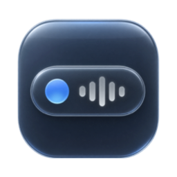
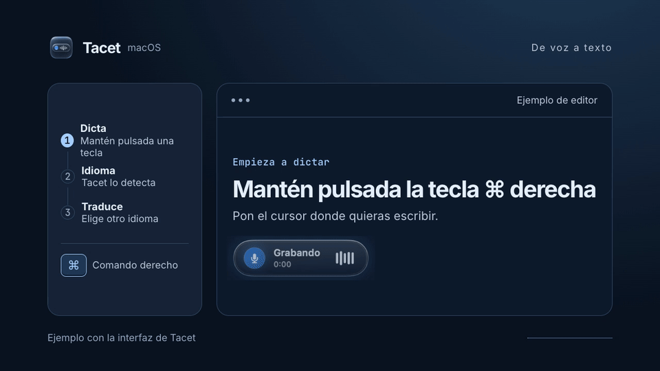

  

<h1 align="center">Tacet</h1>

**Dictado desde la barra de menús de macOS**

[Sitio de Tacet](https://lexus2016.github.io/tacet/?lang=es) · [Demostración](https://lexus2016.github.io/tacet/?lang=es#demo) · **[Descargar para Mac](https://github.com/Lexus2016/tacet/releases/latest)**

[English](README.md) · [Українська](README.uk.md) · [Deutsch](README.de.md) · Español · [Français](README.fr.md) · [Italiano](README.it.md) · [Polski](README.pl.md) · [Português](README.pt.md) · [Русский](README.ru.md)

Mantén pulsada la tecla Comando derecha, habla y suéltala. Tacet escribe tus palabras en el chat, correo o documento que tienes abierto. Dicta un mensaje en un idioma y el siguiente correo en otro. Tacet puede detectar el idioma cada vez, sin que tengas que cambiar los ajustes.

Selecciona una frase y di «Hazla más corta», «Dale un tono más cercano» o «Tradúcela al español». Para editar con la voz, configura antes un servicio de texto.

[Qué resuelve](https://lexus2016.github.io/tacet/?lang=es#features)

## De la voz a una frase

Mira el indicador de grabación, la detección automática del idioma y un ejemplo de traducción opcional.

| Ajustes | Historial |
| --- | --- |
|  |  |

## Funciones

- **Cambia de idioma durante el día** Deja que Tacet detecte el idioma de cada dictado o fija el que prefieras.
- **Habla en un idioma. Escribe en otro.** Elige un idioma de salida y conecta un proveedor de texto. Tacet puede insertar la traducción en la misma aplicación.
- **Elige dónde se reconoce la voz** Descarga Parakeet para reconocer la voz en tu Mac o configura un proveedor en la nube. Las funciones opcionales en la nube envían datos al proveedor elegido.
- **Conserva el portapapeles** Tacet restaura el portapapeles después de la inserción automática y guarda las transcripciones en el historial.

## Instalación

macOS 14+ · Apple Silicon e Intel · Notarizado por Apple

- Apple Silicon · `arm64.dmg`
- Intel · `x86_64.dmg`

Abre la imagen de disco para tu Mac, arrastra Tacet a Aplicaciones y permite el acceso al micrófono. Para la inserción automática, activa Accesibilidad.

[Versiones](https://github.com/Lexus2016/tacet/releases/latest) · [GPL-3.0](LICENSE)
