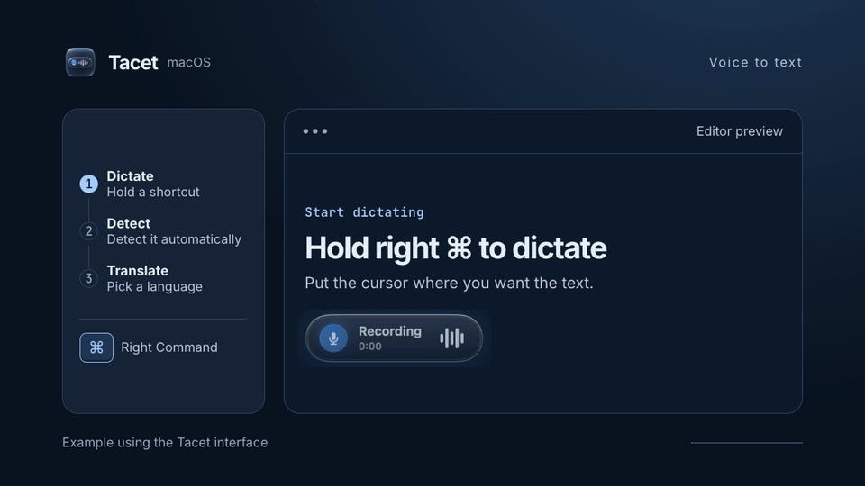

<p align="center">
  
</p>

<h1 align="center">Tacet</h1>

<p align="center"><strong>Voice dictation and editing for Mac</strong></p>

<p align="center">
  <a href="https://lexus2016.github.io/tacet/"><strong>Tacet website</strong></a>
  · <a href="https://github.com/Lexus2016/tacet/releases/latest">Download Tacet</a>
</p>

English · [Українська](README.uk.md) · [Deutsch](README.de.md) · [Español](README.es.md) · [Français](README.fr.md) · [Italiano](README.it.md) · [Polski](README.pl.md) · [Português](README.pt.md) · [Русский](README.ru.md)

Hold the right Command key, speak, then let go. Tacet puts your words into the chat, email or document you already have open. It can detect the language each time, so you can dictate your next message in a different language without changing settings.

Select a sentence and tell Tacet what to do with it: “Make this shorter,” “Make it friendlier,” or “Translate this into Spanish.” Voice edits and translation use Tacet Ensemble, our cloud engine. When you are offline or out of minutes, Tacet Solo keeps dictation going on your Mac.

[See the voice features in GIFs](https://lexus2016.github.io/tacet/#features)

## From voice to a sentence

See the recording indicator, automatic language detection and an example of optional translation.

[](https://lexus2016.github.io/tacet/?lang=en#demo)

| Settings | History |
| --- | --- |
|  |  |

## Install on macOS 14 or later

1. On the [latest release page](https://github.com/Lexus2016/tacet/releases/latest), download the Apple-notarized disk image ending in `arm64.dmg` for Apple Silicon or `x86_64.dmg` for Intel. Open it and drag Tacet to Applications.
2. Open Tacet and sign in with your email: Tacet sends you a code. A short tour of ten steps then shows each feature. Dictation stays locked until the tour is finished, and Tacet Solo downloads in the background.
3. The tour asks for microphone and Accessibility access. Hold the right Command key to dictate. You can record a different shortcut or switch to start-and-stop mode in **Settings → General**.
4. Place the cursor in the editor and speak. When automatic insertion is off, Tacet copies the result for you to paste. If the original editor is unavailable, find the transcript in **History**.

## Dictation and editing

- **Recognition.** Tacet Ensemble recognizes speech in the cloud, detects the language of each dictation and fixes punctuation and wording. Tacet Solo is a model on your Mac that keeps dictation going without a connection.
- **Cleanup and translation.** Tacet Ensemble fixes punctuation and wording or translates the result. The original transcript remains available in History.
- **Edit a selection.** Select up to 1,000 words and dictate a change. Tacet checks the original editor and selection before replacing it through automatic insertion. If it cannot verify the selection, it saves a result or the instruction in History.
- **Recover a recording.** History can play saved audio and retry a failed recording. Configure audio retention under **General**.
- **Indicator.** Choose Classic, Glass, or Light and place the indicator at the top or bottom of the screen.

Tacet Ensemble sends your audio and the transcribed text to Tacet’s service and to the third-party model providers it uses to produce the result. Tacet Solo processes audio on your Mac after its model is downloaded. Your Tacet account is your email address; its sign-in token lives in the macOS Keychain.

## Plans

- **Free:** 100 minutes of Tacet Ensemble once, then Tacet Solo without limits. 2 devices.
- **Basic and Pro:** more Tacet Ensemble minutes and devices. Paid plans are coming soon; until then every account is on Free.

## Updates

Tacet checks for updates once a day. Starting with 0.2.26, it defaults to installing updates in the background and relaunches after dictation and transcription finish. Existing update preferences are respected. If automatic installation was off in your previous version, open **About → Check for Updates…** to confirm the upgrade.

## Build from source

```bash
./scripts/bootstrap.sh
./scripts/build.sh
xcodebuild test -project Tacet.xcodeproj -scheme Tacet -destination 'platform=macOS'
```

To publish a pushed revision, run `scripts/release.sh <major.minor.patch>` on a Mac configured for release signing. It builds and notarizes both architectures, verifies the signed Sparkle feeds and draft files, and publishes the release.

Tacet is distributed under [GPL-3.0](LICENSE) and based on [TypeWhisper](https://github.com/TypeWhisper/typewhisper-mac). See [NOTICE](NOTICE).
