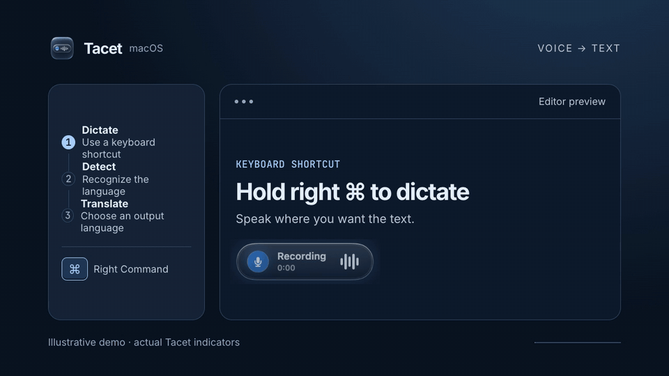

  

<h1 align="center">Tacet</h1>

**Dyktowanie z paska menu macOS**

[Strona Tacet](https://lexus2016.github.io/tacet/?lang=pl) · [Demo](https://lexus2016.github.io/tacet/?lang=pl#demo) · **[Pobierz na Maca](https://github.com/Lexus2016/tacet/releases/latest)**

[English](README.md) · [Українська](README.uk.md) · [Deutsch](README.de.md) · [Español](README.es.md) · [Français](README.fr.md) · [Italiano](README.it.md) · Polski · [Português](README.pt.md) · [Русский](README.ru.md)

Przytrzymaj skrót i dyktuj w aplikacji, z której już korzystasz. Tacet rozpoznaje język i może przetłumaczyć tekst na wybrany język.

## Od głosu do gotowego zdania

Zobacz wskaźnik nagrywania, automatyczne wykrywanie języka i przykład tłumaczenia.

| Ustawienia | Historia |
| --- | --- |
|  |  |

## Funkcje

- **Zmieniaj język w ciągu dnia** Pozwól Tacet wykrywać język przy każdym dyktowaniu lub ustaw wybrany język.
- **Mów w jednym języku. Pisz w innym.** Wybierz język wyjściowy i podłącz usługę przetwarzania tekstu. Tacet może wstawić tłumaczenie w tej samej aplikacji.
- **Wybierz miejsce rozpoznawania mowy** Pobierz Parakeet, by rozpoznawać mowę na Macu, lub skonfiguruj usługę w chmurze. Opcjonalne funkcje chmurowe przesyłają dane do wybranej usługi.
- **Zachowaj zawartość schowka** Tacet przywraca schowek po automatycznym wstawianiu i zapisuje transkrypcje w historii.

## Instalacja

macOS 14+ · Apple Silicon i Intel · Notaryzacja Apple

- Apple Silicon · `arm64.dmg`
- Intel · `x86_64.dmg`

Otwórz obraz dysku dla swojego Maca, przeciągnij Tacet do Aplikacji i zezwól na dostęp do mikrofonu. Aby włączać automatyczne wstawianie, nadaj uprawnienia dostępności.

[Wydania](https://github.com/Lexus2016/tacet/releases/latest) · [GPL-3.0](LICENSE)
