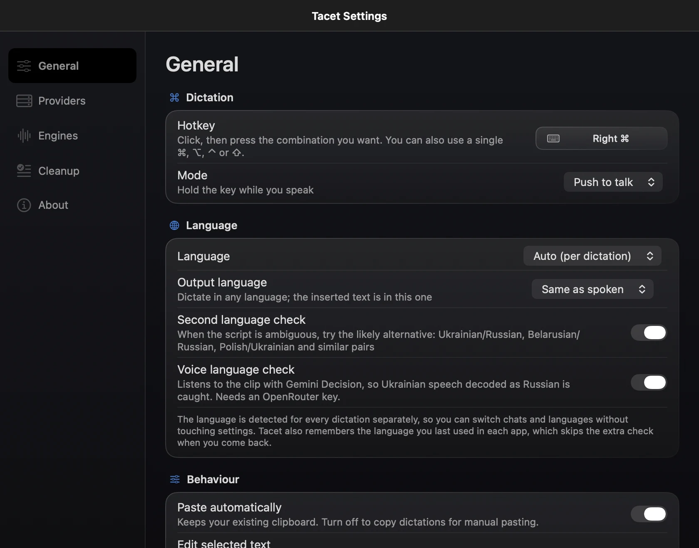

  

<h1 align="center">Tacet</h1>

**Ditado na barra de menus do macOS**

[Site do Tacet](https://lexus2016.github.io/tacet/?lang=pt) · [Demonstração](https://lexus2016.github.io/tacet/?lang=pt#demo) · **[Transferir para Mac](https://github.com/Lexus2016/tacet/releases/latest)**

[English](README.md) · [Українська](README.uk.md) · [Deutsch](README.de.md) · [Español](README.es.md) · [Français](README.fr.md) · [Italiano](README.it.md) · [Polski](README.pl.md) · Português · [Русский](README.ru.md)

Mantém premida a tecla Comando direita, fala e solta-a. O Tacet insere as tuas palavras no chat, e-mail ou documento que tens aberto. Dita uma mensagem num idioma e o próximo e-mail noutro. O Tacet pode detetar o idioma de cada vez, sem mudares as definições.

Selecione uma frase e peça ao Tacet para a encurtar, torná-la mais simpática ou traduzi-la para espanhol. Para isso o Tacet usa o Tacet Ensemble, o seu motor na nuvem.

[O que resolve](https://lexus2016.github.io/tacet/?lang=pt#features)

## Da voz à frase

Veja o indicador de gravação, a deteção automática da língua e um exemplo de tradução.

| Definições | Histórico |
| --- | --- |
|  |  |

## Funcionalidades

- **Mude de língua ao longo do dia** Deixe o Tacet reconhecer a língua de cada ditado ou fixe a língua pretendida.
- **Fale numa língua. Escreva noutra.** Escolha a língua de saída. O Tacet Ensemble pode inserir a tradução na mesma app.
- **Na nuvem ou no seu Mac** O Tacet Ensemble dá o melhor resultado online e, para isso, envia áudio e texto ao serviço Tacet e aos seus fornecedores de modelos. Sem ligação ou sem minutos, o Tacet Solo continua a ditar no seu Mac.
- **Preserve a área de transferência** O Tacet repõe a área de transferência após a inserção automática e guarda transcrições no histórico.

## Instalação

macOS 14+ · Apple Silicon e Intel · Notarizado pela Apple

- Apple Silicon · `arm64.dmg`
- Intel · `x86_64.dmg`

Abra a imagem de disco do seu Mac, arraste o Tacet para Aplicações e, na primeira abertura, inicie sessão com o seu e-mail. Permita o acesso ao microfone e, para a inserção automática, à Acessibilidade. O plano Free inclui 100 minutos do Tacet Ensemble uma só vez e o Tacet Solo sem limite; os planos pagos chegam em breve.

[Versões](https://github.com/Lexus2016/tacet/releases/latest) · [GPL-3.0](LICENSE)
