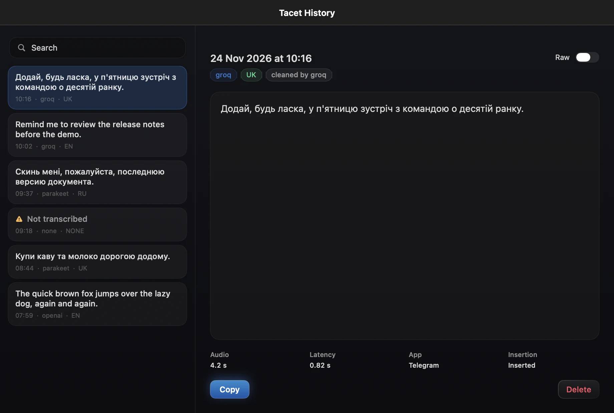

  

<h1 align="center">Tacet</h1>

**Диктовка из строки меню macOS**

[Сайт Tacet](https://lexus2016.github.io/tacet/?lang=ru) · [Демонстрация](https://lexus2016.github.io/tacet/?lang=ru#demo) · **[Скачать для Mac](https://github.com/Lexus2016/tacet/releases/latest)**

[English](README.md) · [Українська](README.uk.md) · [Deutsch](README.de.md) · [Español](README.es.md) · [Français](README.fr.md) · [Italiano](README.it.md) · [Polski](README.pl.md) · [Português](README.pt.md) · Русский

Зажмите правую клавишу ⌘, скажите фразу и отпустите клавишу. Tacet вставит ваши слова в открытый чат, письмо или документ. Продиктуйте сообщение в чате на одном языке, а следующее письмо — на другом. Tacet может определять язык каждый раз, поэтому менять настройки вручную не нужно.

Выделите предложение и скажите «Сделай короче», «Сделай тон дружелюбнее» или «Переведи на испанский». Для голосовых правок настройте сервис обработки текста.

## От голоса к готовой фразе

Посмотрите на индикатор записи, автоматическое определение языка и пример перевода.

| Настройки | История |
| --- | --- |
|  |  |

## Возможности

- **Меняйте язык в течение дня** Разрешите Tacet определять язык при каждой диктовке или задайте его вручную.
- **Говорите на одном языке. Пишите на другом.** Выберите язык результата и подключите сервис обработки текста. Tacet может вставить перевод в то же приложение.
- **Выберите, где распознавать речь** Загрузите Parakeet для распознавания на Mac или настройте облачный сервис. Дополнительные облачные функции отправляют данные выбранному сервису.
- **Сохраняйте содержимое буфера обмена** Tacet восстанавливает содержимое буфера обмена после автоматической вставки и сохраняет тексты в истории.

## Установка

macOS 14+ · Apple Silicon и Intel · Нотаризация Apple

- Apple Silicon · `arm64.dmg`
- Intel · `x86_64.dmg`

Откройте образ для своего Mac, перетащите Tacet в «Программы» и разрешите доступ к микрофону. Для автоматической вставки разрешите универсальный доступ.

[Выпуски](https://github.com/Lexus2016/tacet/releases/latest) · [GPL-3.0](LICENSE)
