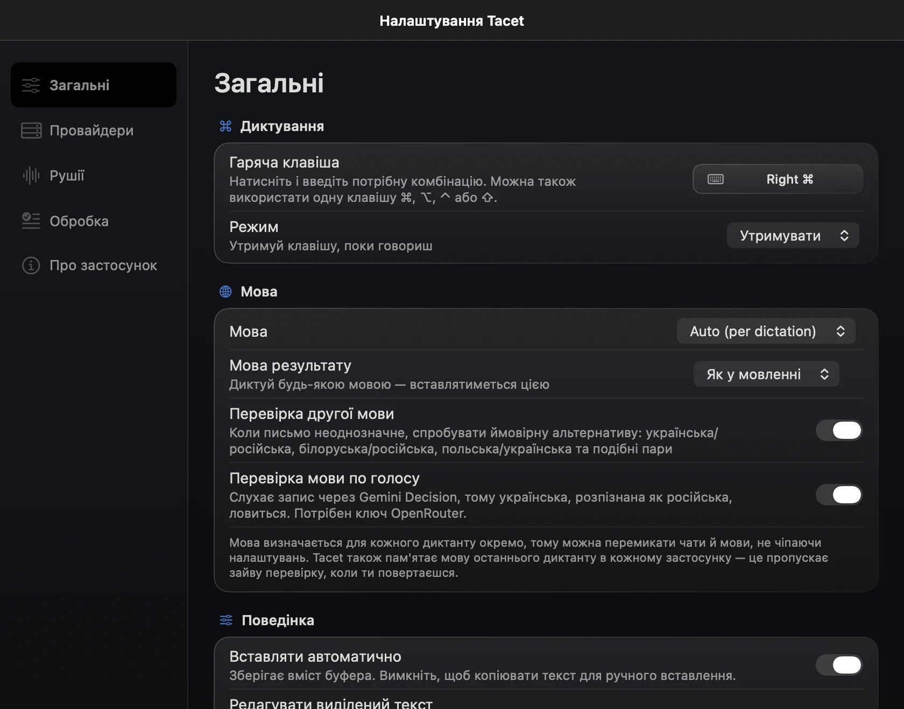
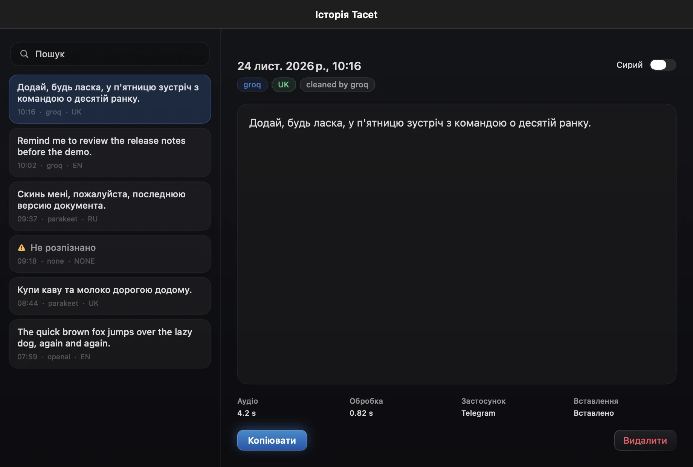

<p align="center">
  
</p>

<h1 align="center">Tacet</h1>

<p align="center"><strong>Диктування для macOS із рядка меню</strong></p>

<p align="center">
  <a href="https://lexus2016.github.io/tacet/?lang=uk"><strong>Сайт Tacet</strong></a>
  · <a href="https://github.com/Lexus2016/tacet/releases/latest">Завантажити Tacet</a>
</p>

[English](README.md) · Українська · [Deutsch](README.de.md) · [Español](README.es.md) · [Français](README.fr.md) · [Italiano](README.it.md) · [Polski](README.pl.md) · [Português](README.pt.md) · [Русский](README.ru.md)

Утримуйте праву клавішу ⌘, говоріть і відпустіть її. Tacet вставить ваші слова у відкритий чат, лист або документ. Продиктуйте повідомлення в чаті однією мовою, а наступний лист — іншою. Tacet може розпізнати мову щоразу, тож перемикати її вручну не потрібно.

Виділіть речення й скажіть «Напиши коротше», «Зроби тон дружнішим» або «Переклади іспанською». Для голосових правок під’єднайте сервіс обробки тексту.

[Як допомагає](https://lexus2016.github.io/tacet/?lang=uk#features)

## Від голосу до готового речення

Подивіться на індикатор запису, автоматичне визначення мови й приклад перекладу.

[](https://lexus2016.github.io/tacet/?lang=uk#demo)

| Налаштування | Історія |
| --- | --- |
|  |  |

## Встановлення на macOS 14 або новішій

1. На [сторінці останнього випуску](https://github.com/Lexus2016/tacet/releases/latest) завантажте образ диска, який пройшов нотаризацію Apple. Для Apple Silicon виберіть файл із закінченням `arm64.dmg`, а для Intel — `x86_64.dmg`. Відкрийте образ і перетягніть Tacet у «Програми».
2. У **Налаштування → Провайдери** завантажте Parakeet для локального розпізнавання або під’єднайте хмарний сервіс. У розділі **Рушії** можна змінити порядок, у якому Tacet їх пробує.
3. У розділі **Загальні** надайте доступ до мікрофона й універсального доступу. Для диктування утримуйте праву клавішу Command. Можна записати іншу комбінацію або вибрати режим «натиснути для початку й завершення».
4. Поставте курсор у редакторі й говоріть. Якщо автоматичне вставлення вимкнено, Tacet копіює результат для ручного вставлення. Якщо початковий редактор недоступний, знайдіть текст в **Історії**.

## Диктування й редагування

- **Розпізнавання.** Виберіть мову або дозвольте Tacet визначати її для кожного диктанту. Інший рушій підхопить запис, якщо попередній виявиться недоступним.
- **Обробка й переклад.** Виберіть налаштований сервіс для виправлення пунктуації або перекладу результату. В історії доступний і початковий текст.
- **Редагування виділення.** Виділіть текст і продиктуйте зміни. Перед автоматичною заміною Tacet перевірить початковий редактор і виділення. Якщо підтвердити виділення не вдалося, результат або команда залишаться в історії.
- **Відновлення записів.** В історії можна прослухати збережене аудіо й повторити розпізнавання. Термін зберігання змінюється в розділі **Загальні**.
- **Індикатор.** Виберіть класичну, скляну або світлу тему та розмістіть індикатор угорі чи внизу екрана.

Після завантаження моделі локальне розпізнавання працює на Mac. Аудіо надсилається на вибрані хмарні сервіси під час хмарного розпізнавання або додаткової перевірки мови за голосом. Для обробки, перекладу та редагування виділення вибраному сервісу надсилається текст. Ключі доступу зберігаються у в’язці ключів macOS.

## Оновлення

Tacet перевіряє оновлення раз на добу. Починаючи з 0.2.26, за замовчуванням він встановлює їх у фоновому режимі й перезапускається після завершення диктування та розпізнавання. Збережені налаштування оновлень діють і далі. Якщо у попередній версії автоматичне встановлення було вимкнено, відкрийте **Про застосунок → Перевірити оновлення…** і підтвердьте перехід.

## Збірка з вихідного коду

```bash
./scripts/bootstrap.sh
./scripts/build.sh
xcodebuild test -project Tacet.xcodeproj -scheme Tacet -destination 'platform=macOS'
```

Щоб опублікувати версію з коміту, уже надісланого до репозиторію, запустіть `scripts/release.sh <major.minor.patch>` на Mac із налаштованим підписанням. Сценарій збирає й нотаризує обидві версії, перевіряє підписані канали Sparkle й файли в чернетці та публікує випуск.

Tacet поширюється за [GPL-3.0](LICENSE) і створений на основі [TypeWhisper](https://github.com/TypeWhisper/typewhisper-mac). Див. [NOTICE](NOTICE).
